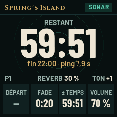

# Spring's Sonar — firmware pour le M-VAVE FM-1

Le sonar d'ambiance du scénario **Spring's Island** (Les Chants de Tindalos), directement sur le synthétiseur
M-VAVE FM-1 : un ping émis, son pong qui revient, de plus en plus rapprochés jusqu'au bip continu final. La même
chose que la page web [CDT Compagnon](https://bananebleue.github.io/CDT-Ambiance/), sans téléphone.

> **État : version de développement, jamais installée sur un FM-1.** Le cœur du son et l'interface sont testés
> sur ordinateur (voir *Tests*) ; la compilation se fait sur GitHub. Lisez [docs/INSTALLER.md](docs/INSTALLER.md)
> avant le premier essai.

<p align="center"></p>

## Les commandes

| Commande | Effet |
| --- | --- |
| Molette 1 | Délai avant départ (0 par défaut ; 5 s par cran, 1 min au-delà de 2 min) |
| Molette 2 | Fade-in (5 s par cran) |
| Molette 3 | Durée du sonar ; en jeu, ajoute ou retire du temps (1 min par cran, 10 s sous 5 min) |
| Molette 4 | Volume (2 % par cran) |
| ALGORITHM | Réverbération générale, par-dessus tout le son |
| SELECT | Type de son : Abysse, Coque, Métal, Clic, Sonde, Impulsion (sans affichage) |
| Touches du clavier | Écouter un ping et son pong : avant le départ, ou une fois quand le son est coupé |
| OCT− / OCT+ | Tonalité, un demi-ton par appui |
| PLAY | Au repos : lancer. Ensuite : couper le son (le décompte continue) ; le rétablir d'un appui court, ou en fondu d'un appui long |
| REC, maintenu 1 s | Arrêter et réinitialiser |
| PRESETS | Faire défiler les presets, puis « + Nouveau » |
| SAVE | Enregistrer dans le preset affiché, ou en créer un sur « + Nouveau » |
| MASTER | Volume de sortie du FM-1 |

Les valeurs ne descendent jamais sous zéro et n'ont pas de butée haute (12 h au plus). Les réglages et les presets
sont gardés en mémoire flash. La LED PLAY s'éteint brièvement à chaque ping ; SAVE s'allume quand les réglages
diffèrent du preset affiché.

## L'heure et les noms de presets

Le FM-1 n'a pas d'horloge sauvegardée : la page CDT Compagnon lui envoie l'heure par USB (contrôleurs MIDI sur le
canal 16), puis il compte seul. Sans cela, l'écran affiche « heure non synchronisée » et seulement les durées.

| CC (canal 16) | Valeur |
| --- | --- |
| 102, 103, 104 | heure, minute, seconde |
| 105 | valider l'heure |
| 110 | numéro du preset à renommer (0 = P1) |
| 111 | un caractère du nom (ASCII 32..126), répété |
| 112 | valider le nom |

## Le son

Tout est synthétisé en nombres entiers (la puce n'a pas de virgule flottante) : partiels sinusoïdaux, enveloppes,
clic de bruit filtré, trois réverbérations de type Freeverb (celle des pings, celle de la pré-écoute, la générale).
Les courbes et les six types sont ceux de la page web : voir le README du dépôt.

## Arborescence

```
firmware/sonar/sonar_core.c    le déroulé et le son (sans matériel)
firmware/sonar/sonar_ui.c      l'interface et l'écran (sans matériel)
firmware/sonar/sonar_tables.h  constantes (tools/gen_sonar_tables.py)
firmware/sonar/sonar_fonts.h   polices lissées (tools/gen_sonar_fonts.py)
firmware/src/spring_sonar.c    le raccordement à la plateforme Dinghy
firmware/src, hal, loader      la plateforme Dinghy / Felucca / SLOOP (mises à jour, secours USB, écran, flash…)
tests/sonar_core_test.c        banc d'essai du cœur : une partie accélérée, des vérifications, un WAV
tests/sonar_ui_host.c          banc d'essai de l'interface : molettes, boutons, captures d'écran, un WAV
```

## Compiler

Sur GitHub : chaque envoi sur la branche `firmware` compile le paquet et lance les bancs d'essai
(`.github/workflows/fm1-firmware.yml`) ; le paquet est dans les artefacts de l'exécution. Une étiquette `fm1-vX.Y`
publie une version (identité `FM-1_96Y`).

En local (Linux x86-64), comme Dinghy : `tools/get_toolchain.sh`, le SDK JieLi AC79 (voir [docs/DINGHY.md](docs/DINGHY.md)),
puis `sh build.sh` → `build/spring-sonar.fwsc`.

## Tests

```sh
cc -O2 -Wall -Ifirmware/sonar -o build/sonar_core_test tests/sonar_core_test.c && build/sonar_core_test build/sonar_core.wav
cc -O2 -Wall -Ifirmware/sonar -o build/sonar_ui_host tests/sonar_ui_host.c && build/sonar_ui_host build/ui tests/sonar_ui_script.txt
```

## Licence

GPL-3.0-only, comme Dinghy, Felucca et SLOOP sur lesquels il repose. Détails et crédits : [LICENSING.md](LICENSING.md).
